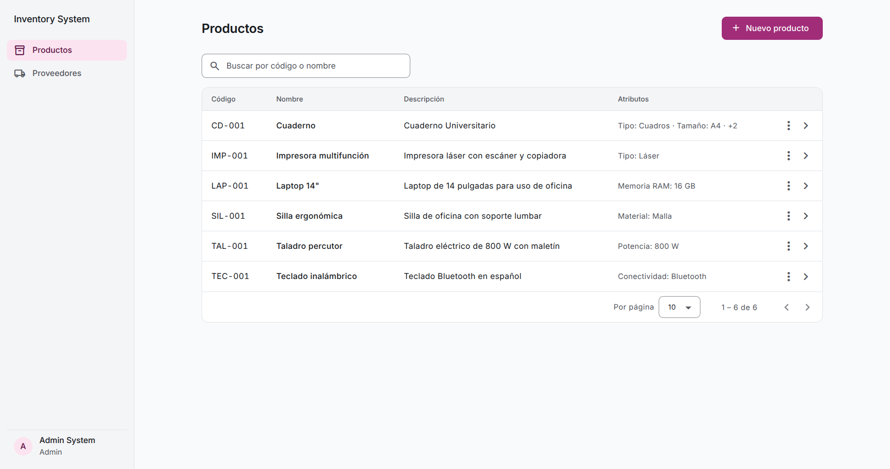
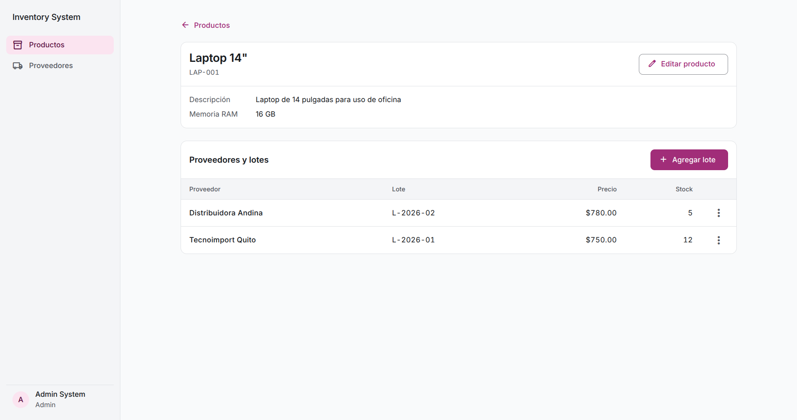

# inventory-system

Product inventory system: Angular, .NET 10 and SQL Server. Users log in with JWT, and each product can have a different price and stock per supplier or lot.

## Screenshots






## Run the API with Docker

```bash
cp .env.example .env
docker compose up --build
```

- API: http://localhost:8080
- Swagger: http://localhost:8080/swagger

Migrations and demo data are applied automatically. The demo users come from the `Seed__*` variables in `.env`.

## Local development

```bash
docker compose up -d db
cd backend
dotenv -e ../.env -- dotnet ef database update --project src/Inventory.Infrastructure --startup-project src/Inventory.Api
dotnet run --project src/Inventory.Api
```

The API listens on http://localhost:5078. For the frontend:

```bash
cd frontend
npm install
npm start
```

It runs on http://localhost:4200 and talks to the API on port 5078.

## More

- Backend decisions: [backend/docs/decisions.md](backend/docs/decisions.md)
- Frontend decisions and architecture: [frontend/docs/decisions.md](frontend/docs/decisions.md), [frontend/docs/architecture.md](frontend/docs/architecture.md)
- Architecture and conventions: [backend/docs/architecture/architecture.md](backend/docs/architecture/architecture.md), [backend/docs/conventions.md](backend/docs/conventions.md)
