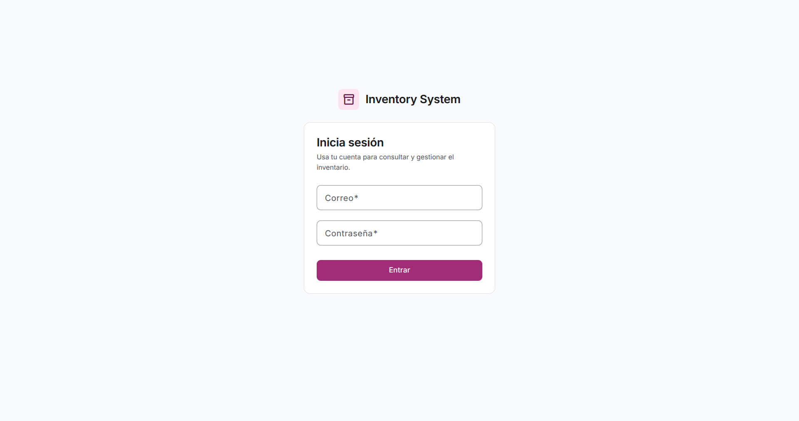

# inventory-system

Product inventory system: Angular, .NET 10 and SQL Server. Users log in with JWT, and each product can have a different price and stock per supplier or lot.

## Screenshots




## Run with Docker

```bash
cp .env.example .env
docker compose up --build
```

- App: http://localhost:4200
- API: http://localhost:8080
- Swagger: http://localhost:8080/swagger

Migrations and demo data are applied automatically. The demo users come from the `Seed__*` variables in `.env`.

## Local development

```bash
docker compose up -d db
cd backend
dotenv -e ../.env -- dotnet ef database update --project src/Inventory.Infrastructure --startup-project src/Inventory.Api
dotnet run --project src/Inventory.Api
```

The API listens on http://localhost:5078. For the frontend:

```bash
cd frontend
npm install
npm start
```

It runs on http://localhost:4200 and talks to the API on port 5078.

## Deployment

The app runs on an Azure VM (Ubuntu 24.04) with the same Docker Compose stack, plus [docker-compose.prod.yml](docker-compose.prod.yml):

- Caddy is the only public entry point. It serves HTTPS with an automatic Let's Encrypt certificate for `SITE_HOST`, sends `/swagger` to the API and everything else to the web container, which proxies `/api` to the API.
- SQL Server, the API and nginx publish no host ports.
- Services restart on their own after a reboot.

Deploy by hand on the VM, with `.env` in place (including `SITE_HOST`):

```bash
~/inventory-system/deploy/deploy.sh
```

[CI/CD](.github/workflows/ci-cd.yml) runs the backend tests, the frontend tests and build, and the Docker image build on every push and pull request to `main`. On a push to `main` it then runs `deploy/deploy.sh` on the VM over SSH. It needs these secrets in the `production` environment: `DEPLOY_HOST`, `DEPLOY_USER`, `DEPLOY_SSH_KEY` and `DEPLOY_KNOWN_HOSTS`.

## More

- Backend decisions: [backend/docs/decisions.md](backend/docs/decisions.md)
- Frontend decisions and architecture: [frontend/docs/decisions.md](frontend/docs/decisions.md), [frontend/docs/architecture.md](frontend/docs/architecture.md)
- Architecture and conventions: [backend/docs/architecture/architecture.md](backend/docs/architecture/architecture.md), [backend/docs/conventions.md](backend/docs/conventions.md)
- How to make common changes, backend and frontend: [docs/playbook/README.md](docs/playbook/README.md)
